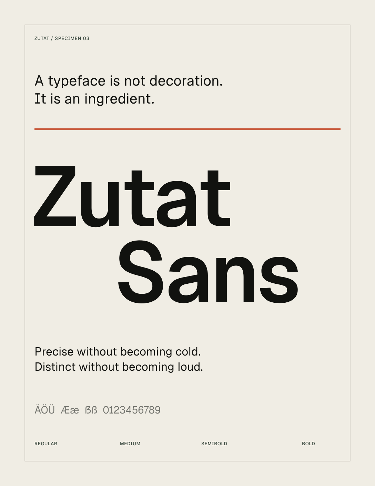

# Zutat Sans



Zutat Sans is a contemporary sans-serif shaped by quiet authority, editorial
precision, and restrained character. It is designed for product interfaces,
brand systems, editorial typography, and digital communication.

The family currently includes four upright static weights:

| Style | Weight |
| --- | ---: |
| Regular | 400 |
| Medium | 500 |
| SemiBold | 600 |
| Bold | 700 |

## Install

Download TTF, OTF, and WOFF2 files from the latest GitHub release, or install
the Next.js package:

```sh
npm install zutat-font
```

```tsx
import { ZutatSans } from "zutat-font/font/sans";

export default function RootLayout({ children }) {
  return (
    <html lang="en" className={ZutatSans.variable}>
      <body>{children}</body>
    </html>
  );
}
```

```css
body { font-family: var(--font-zutat); }
```

Use `zutat-font/font/sans-latin` for the smaller Latin web profile. Plain CSS
exports are available as `zutat-font/style.css` and
`zutat-font/style-latin.css`.

## Character support

The complete family contains broad Latin, Vietnamese, and Cyrillic coverage,
common UI symbols, OpenType numeral features, recalibrated kerning and mark
positioning, Windows-safe vertical metrics, and TrueType screen hinting.

## Build

```sh
python3 -m venv .venv
.venv/bin/pip install -r requirements.txt
make build
make test
```

`make posters` recreates the SVG specimens and PNG previews. `make package`
creates the local npm package under `packages/zutat-font`. `make fontbakery`
runs the release checks against both the TrueType and CFF/OpenType builds.

## Repository layout

- `fonts/` — release TTF, OTF, WOFF2, and Latin subsets
- `references/` — pinned OFL-licensed Geist inputs required for offline,
  reproducible builds
- `scripts/` — reproducible Zutat build, validation, packaging, and poster tools
- `packages/zutat-font/` — publishable Next.js/npm package
- `documentation/` — SVG posters, PNG previews, and QA specimens
- `qa/browser/` — Playwright small-UI and browser regression suite

## License

Zutat Sans is a modified typeface derived from Geist by Vercel,
basement.studio, and contributors. It is distributed under the SIL Open Font
License 1.1. See `LICENSE.txt`, `NOTICE.md`, and `UPSTREAM.md`.
